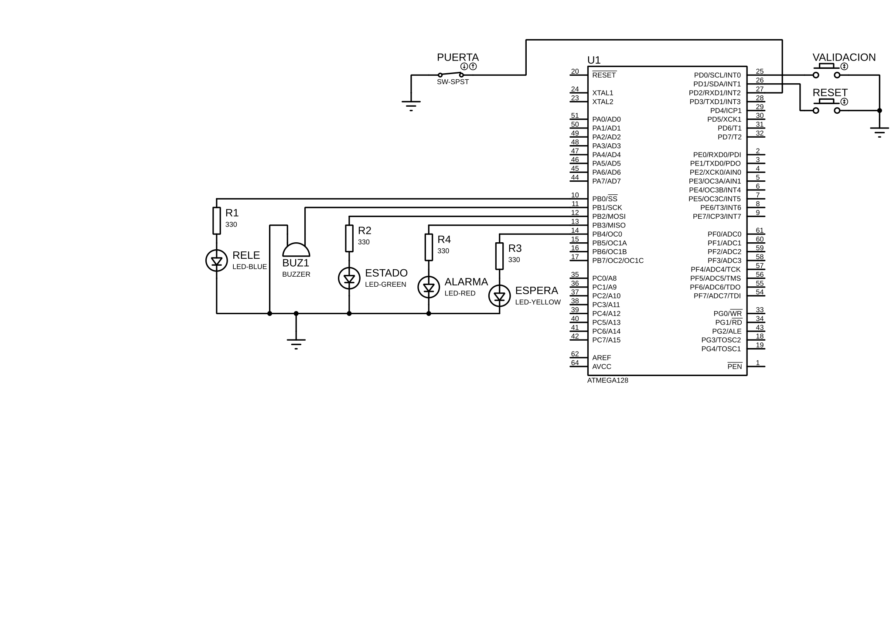

# Trabajo Práctico Integrador - Informática II - UTN Avellaneda 2026
> **Alumno:** Bruno Ziegler

## Memoria Descriptiva

Este repositorio contiene el Trabajo Práctico Integrador de la materia. Para este proyecto, elegí desarrollar un **sistema de control de acceso**. 

Se trata de un sistema de validación de entrada que gestiona una cerradura electromagnética. La máquina de estados validará el ingreso y liberará el relé de la puerta por un tiempo determinado. Fundamentalmente, monitoreará que la puerta no quede abierta por descuido. Si el contacto magnético detecta una apertura forzada (sin validación previa) o un tiempo de puerta abierta superior al permitido, el sistema pasará a un estado de alarma con indicadores sonoros, requiriendo un reinicio manual (*reset*) por parte del operador una vez normalizada la situación.

## Diagrama de la Máquina de Estados

## Variables y Condiciones

* **SET:** Bandera de fin de inicialización.
* **v:** Señal de validación de acceso (0 = No validado, 1 = Validado).
* **p:** Estado del sensor magnético de la puerta (0 = Cerrada, 1 = Abierta).
* **t:** Tiempo transcurrido desde la apertura de la puerta.
* **t_max:** Tiempo máximo permitido con la puerta abierta (10 segundos).
* **r:** Señal de reset manual de alarma (0 = Reposo, 1 = Reiniciar).

## Hardware

El sistema está simulado en Proteus con un ATmega128 a 16 MHz, usando la librería [AVR API](https://github.com/DamRCorba/avr_api) de la cátedra.

| Señal | Pin | Componente |
| :--- | :--- | :--- |
| v | PD0 | Pulsador a GND que simula el lector de tarjeta |
| r | PD1 | Pulsador a GND de reset de alarma |
| p | PD2 | Interruptor a GND que simula el sensor magnético (cerrado = puerta cerrada) |
| Relé | PB0 | Cerradura electromagnética (1 = liberada) |
| Buzzer | PB1 | Sirena de alarma |
| Led verde | PB2 | Estado ESPERA |
| Led rojo | PB3 | Estado ALARMA |
| Led amarillo | PB4 | Estado ACCESO |

Las entradas usan el pull up interno del microcontrolador.

## Esquemático

## Simulación

[Ver video de la simulación](Simulacion.mp4)

## Códigos

* **main.c:** Bucle infinito de la máquina de estados con punteros a funciones.
* **mylib.h:** Estados, tiempos y prototipos.
* **estados.c:** Funciones de estado (`f_inicio`, `f_espera`, `f_acceso`, `f_alarma`).
* **hardware.h:** Definición de pines.
* **hardware.c:** Inicialización del micro, lectura de entradas, manejo de salidas y base de tiempo.
* **Makefile:** Compilación con avr-gcc.

